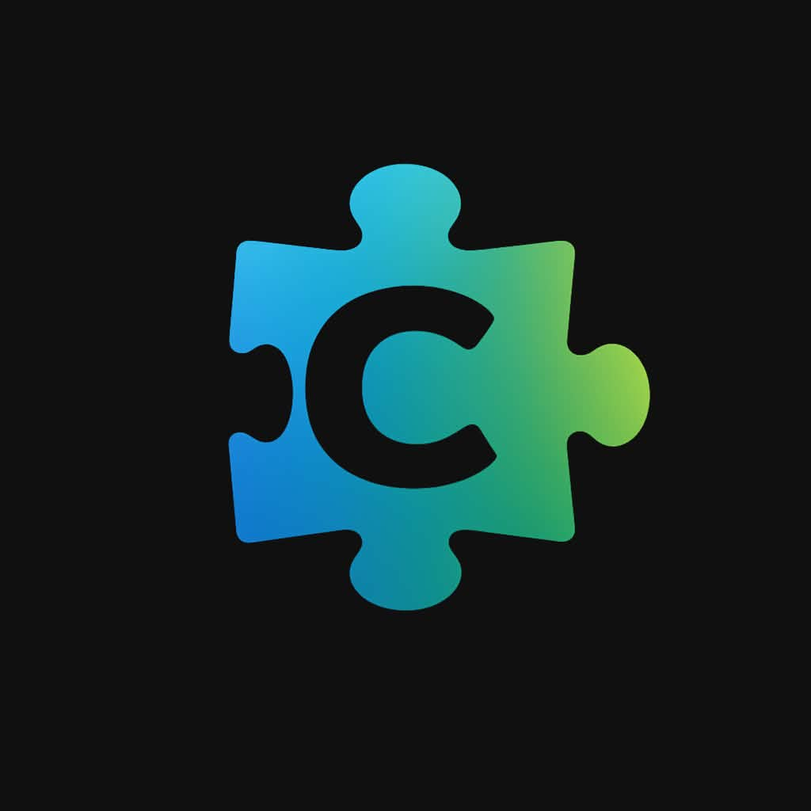

# Claro



**A learning tool first. A programming language second.**

Claro helps beginners learn programming through readable commands, simple rules,
and small programs. Accessibility for people with learning disabilities is a
core design goal; it still needs testing with learners.

Development version: **v2026.10.25.014405**

This is a development snapshot, not a newly published release. See
[current status](docs/CURRENT_STATUS.md) and the dated
[release ledger](docs/RELEASE_STATUS.md) for verified builds and limitations.

## Start here

1. [Build and run Claro](docs/QUICK_START.md).
2. [Try your first programs](docs/FIRST_HOUR.md).
3. [Follow the ten lessons](lessons/README.md), one at a time.

Build with a C89 compiler and `make`, then run the first lesson:

```bash
make
./claro lessons/01_hello.claro
```

On Windows, see the [quick start](docs/QUICK_START.md) for build instructions.

## Your first program

```claro
SAY "Hello!"
ASK "What is your name?" name
SAY "Hello " + name
```

Start with input/output, variables, basic math, decisions, loops, lists,
simple functions, and saving text. You do not need classes, packages,
networking, or advanced types to learn with Claro.

The [beginner syntax guide](docs/SYNTAX.md) gives one recommended form per
concept. Older forms remain supported in a separate compatibility reference.

## Find your way

- `lessons/` — small, ordered lessons.
- `examples/` — programs to try and change.
- [Documentation](docs/README.md) — learning guides and reference.
- [Current roadmap](docs/ROADMAP.md) — the small set of active priorities.
- [Learning-first rules](docs/LEARNING_FIRST.md) — how Claro is designed.
- [Active learning-first roadmap](docs/ROADMAP.md) — current priorities; older platform plans are historical context.
- [Contributing](CONTRIBUTING.md) — source layout, builds, and validation.

Existing features and compatibility syntax remain supported; they are not
required for the beginner path. Experimental features are described in the
[detailed status](docs/CURRENT_STATUS.md), not promised as ready.

Claro scripts run with your permissions. Run only scripts you trust.

## Single-file C89 interpreter

The complete runtime is in [`src/claro.c`](src/claro.c). Build it directly:

```bash
gcc -std=c89 -pedantic-errors src/claro.c -o claro -lm
```

No generated source or project header is required. See [C89 build notes](docs/C89.md)
for platform dependencies, testing, and limitations.

## Downloads and portability

Use the [distribution guide](docs/PORTABILITY.md) to build and verify clean
source, Linux x86-64, and Windows x86-64 archives. Windows execution is tested
under Wine, not yet on a native Windows machine. For VC6 / Windows 98 SE
compilation, use [build98.bat and its guide](docs/WINDOWS98.md).

## License

See [LICENSE](LICENSE).
